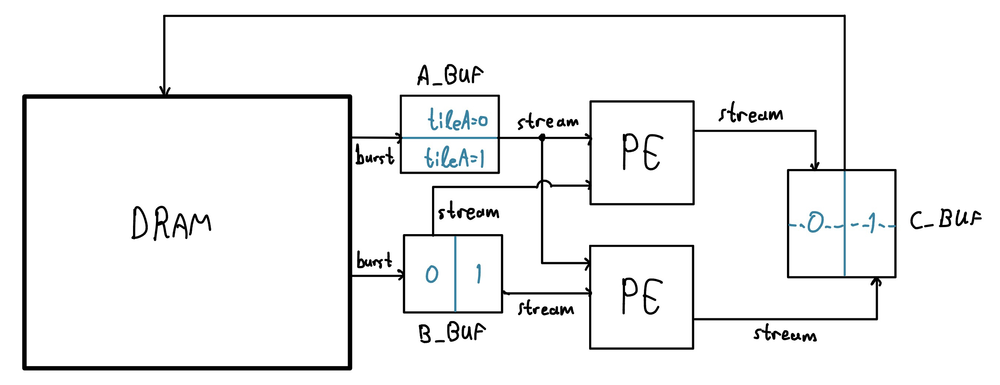
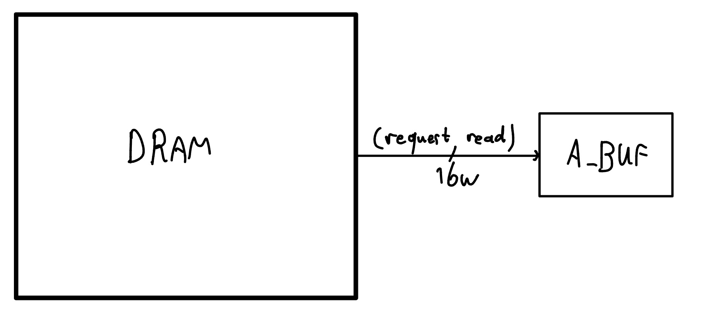
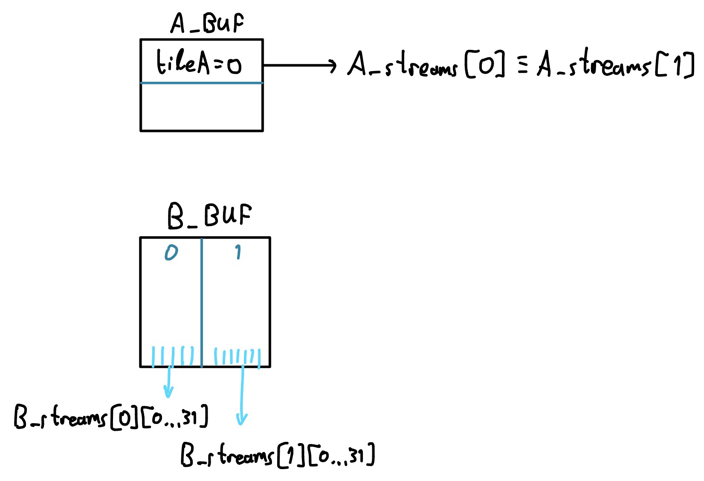
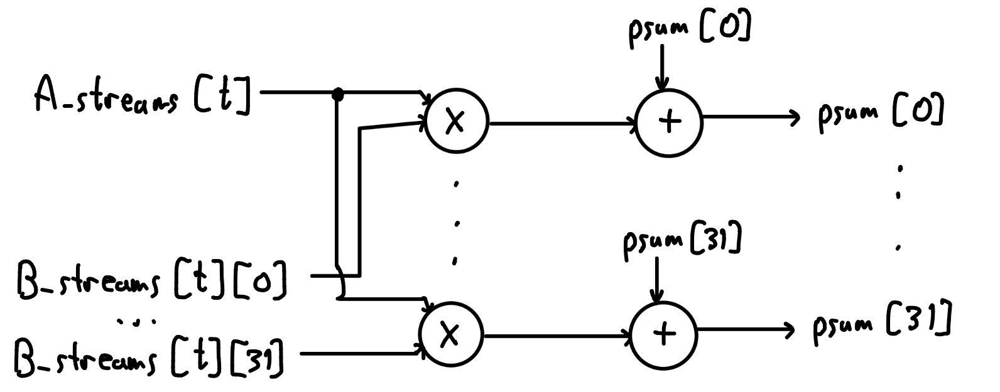
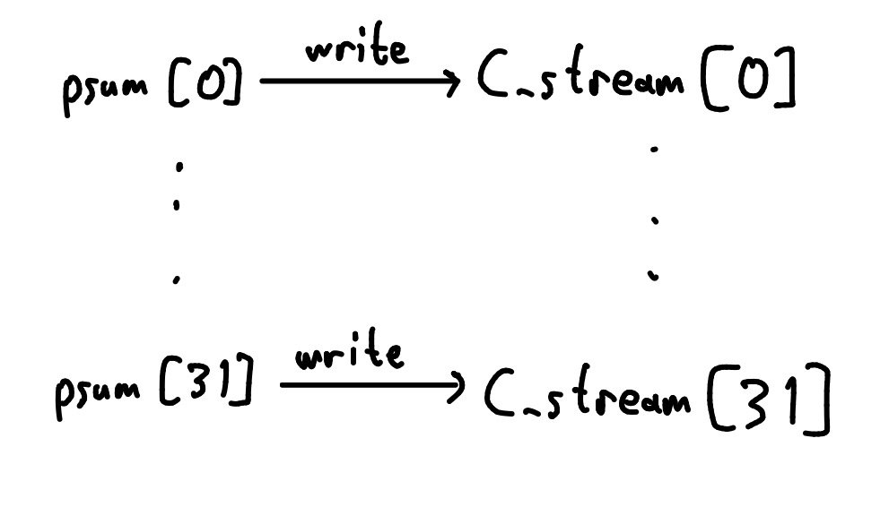
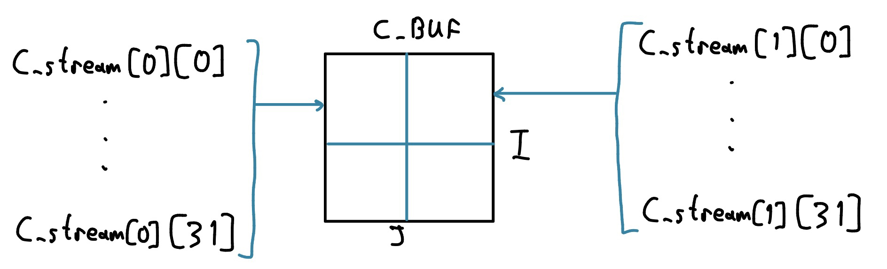
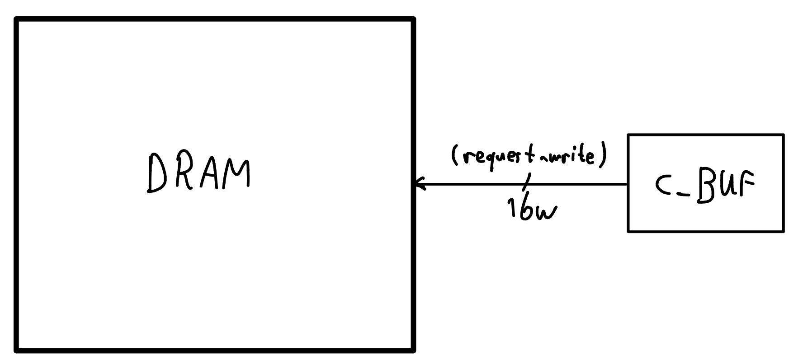
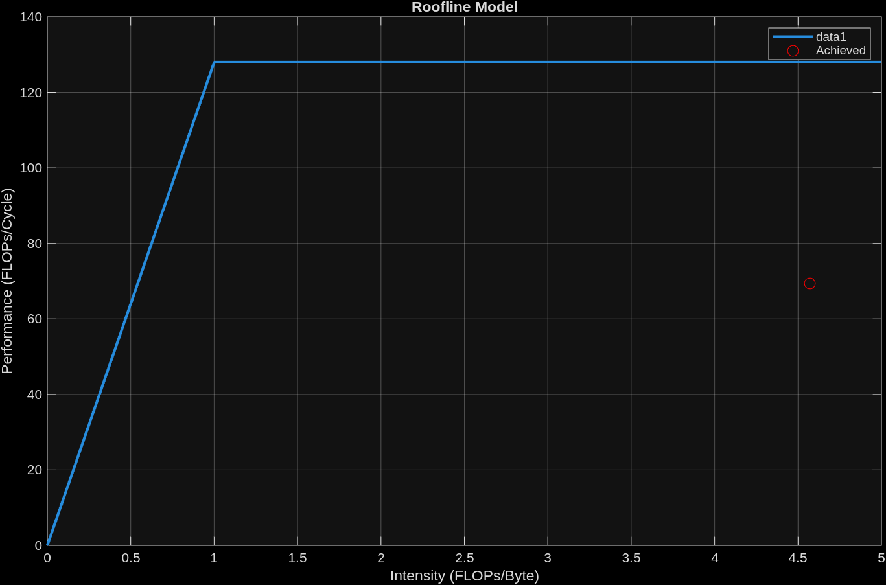

# Output-Stationary Tiled GEMM on Vitis HLS
 


 
This is the first of several projects making up my diploma thesis, **"Exploring GEMM Methods on Versal ACAP Platforms"** (ECE, University of Patras).
 
`outputStationary` is a tiled, dataflow-pipelined single-precision GEMM (`C = A × B`) accelerator written in Vitis HLS and targeting a Versal ACAP device (AI Core series, VCK190). Each output tile keeps its partial sum resident in a register across the whole reduction while operand values stream past it — an **output-stationary** dataflow, as opposed to a weight- or input-stationary design — which is where the repository gets its name. Later projects in the thesis will look at other GEMM strategies on the same platform; systolic-array and AI Engine-based alternatives are noted as future directions below.
 
| | |
|---|---|
| **Target device** | `xcvc1902-vsva2197-2MP-e-S` (Versal AI Core, VCK190), Vitis Kernel Flow |
| **Clock** | 300 MHz target (3.33 ns period) |
| **Problem size** | `A` is 32×16, `B` is 16×64, `C` is 32×64 (`I`×`K` · `K`×`J` → `I`×`J`) |
| **Latency** | 875 cycles (C-synthesis estimate) · 945 cycles (C/RTL co-simulation) |
| **Correctness** | MSE = 0 against a floating-point reference computed in the testbench |
 
## Table of contents
 
- [Architecture](#architecture)
- [Key design techniques](#key-design-techniques)
- [HLS pragma reference](#hls-pragma-reference)
- [Building and running](#building-and-running)
- [Repository structure](#repository-structure)
- [Results](#results)
- [Difficulties and fixes](#difficulties-and-fixes)
- [Status and next steps](#status-and-next-steps)
## Architecture
 

 
`NUM_OF_TILES = 2` tiles both `A`'s rows and `B`'s columns, but **not** in the same way: `A`'s two row-tiles are processed one after another by the outer `loop_for_tile_a` loop, while `B`'s two column-tiles are processed in parallel by two replicated `matMulTile` lanes (PEs) inside each pass. That asymmetry is intentional for now — parallelizing `A`'s tiles too is the first item in [Status and next steps](#status-and-next-steps) — and it is why `C_BUF` ends up split into a 2×2 grid of tiles: 2 sequential row-passes × 2 parallel column-lanes.
 
Each pass of `loop_for_tile_a` (implemented across `dram.hpp`, `loader.hpp` and `usefulFunctions.hpp`) moves data through six stages:
 
#### 1. DRAM to buffer
 

 
`loadAFromDRAM` and `loadBFromDRAM` each issue one `hls::burst_maxi` request per matrix and read the whole operand in 16-float (`VEC_SIZE`) beats, matching the 512-bit AXI data width for 32-bit floats. `B` is loaded the same way as the `A` case pictured above; the unpacked values land in the on-chip `A_BUF`/`B_BUF`.
 
#### 2. Buffer to streams
 

 
`loader_A_tiles` broadcasts the current `A` row-tile identically into both `A_streams[0]` and `A_streams[1]` — both PEs need the same `A` values. `loader_B_tiles` splits `B_BUF` instead: bank `t`'s 32 columns feed `B_streams[t][0..31]`.
 
#### 3. Streams to partial sum calculation
 

 
Inside `calculatepsum`, each PE reads one `A` scalar and 32 `B` values per cycle, drives 32 parallel multipliers, and accumulates into a 32-wide `psum` register — the output-stationary step that gives the repository its name.
 
#### 4. Partial sum calculation to stream
 

 
Once a row's `K`-cycle accumulation finishes, `psumToStream` writes all 32 `psum` lanes out to `C_streams[t][0..31]` in parallel, and `psum` resets for the next row.
 
#### 5. Stream to buffer
 

 
`loader_C_tiles` unpacks each PE's `C_streams` back into its quadrant of `C_BUF`.
 
#### 6. Buffer to DRAM
 

 
After both row-tiles have been processed, `storeOutputToDRAM` packs the whole `C_BUF` into 16-wide vectors and burst-writes it back to DRAM in one request.
 
### Problem-size parameters (`source/host_visible.h`, `source/constants.h`)
 
| Constant | Value | Meaning |
|---|---|---|
| `I` | 32 | Rows of `A` and `C` |
| `J` | 64 | Columns of `B` and `C` |
| `K` | 16 | Shared (reduction) dimension |
| `NUM_OF_TILES` | 2 | Row-tiles of `A` (sequential) **and** column-tiles of `B` (parallel PEs) |
| `VEC_SIZE` | 16 | Floats per AXI burst beat (512-bit bus ÷ 32-bit `float`) |
| Data type | `float` | Single precision throughout |
 
Total work per `gemm2` call: `I×J×K` = 32,768 MACs = 65,536 FLOPs.
 
## Key design techniques
 
- **Task-level pipelining with `DATAFLOW`** — lets loaders, the MAC array and the buffer writers overlap instead of running strictly in sequence.
- **`hls::stream` channels (PIPO)** — decouple producer and consumer loops so `DATAFLOW` can schedule them concurrently rather than as one monolithic block.
- **Manual burst DRAM access with `hls::burst_maxi` + `hls::vector`** — replaces the default one-word-at-a-time AXI handshake with a single explicit burst request per transfer, moving 16 floats per beat.
- **Replicated output-stationary PEs (`UNROLL`)** — two `matMulTile` lanes run in parallel, one per column-tile of `B`, each keeping its own `psum` accumulator resident across the `K`-length reduction.
- **Explicit buffer partitioning (`ARRAY_PARTITION`, `BIND_STORAGE`)** — gives every tile/PE lane its own conflict-free memory port instead of arbitrating for a shared one.
## HLS pragma reference
 
### Memory and interface
 
| Pragma | Applied to | Purpose |
|---|---|---|
| `INTERFACE m_axi` | `A_DRAM`, `B_DRAM`, `C_DRAM` (top-level `gemm2` ports) | Separate AXI4 master bundle per port (`gmem0`/`gmem1`/`gmem2`) so the three transfers can be scheduled independently; `depth=` sizes each port from the actual element count and `max_read_burst_length`/`max_write_burst_length` caps bursts at `VEC_SIZE` (16) beats. |
| `BIND_STORAGE` | `A_BUF`, `C_BUF` | Explicitly maps both to block RAM (`RAM_1WNR`) rather than leaving the choice to the tool. |
| `ARRAY_PARTITION` | `A_BUF`, `B_BUF`, `C_BUF`, `psum` | `block factor=NUM_OF_TILES` along the tiled dimension(s) so each tile/PE gets its own bank; `complete` along dimensions that must move in one cycle (e.g. all 32 `psum` lanes, all `K` elements of a row). |
| `STREAM` | `A_streams`, `B_streams` (depth 4), `C_streams` (depth 2) | Declares each as a PIPO (ping-pong) buffer rather than a true FIFO, with depth tuned so the channel doesn't stall before the consumer side of the `DATAFLOW` region is ready. |
 
### Scheduling and control
 
| Pragma | Applied to | Purpose |
|---|---|---|
| `DATAFLOW` | `loop_for_tile_a` (in `gemm2`), `matMulTiles`, `matMulTile`'s row loop, `loader_B_tiles`, `loader_C_tiles`, `calculatepsum` | Lets independent iterations / helper calls run concurrently and pipeline at the task level instead of each one finishing fully before the next starts. |
| `STABLE` | `A_BUF`, `B_BUF`, `C_BUF`, inside `loop_for_tile_a` | Tells the scheduler these buffers aren't written inside the `DATAFLOW` region they're declared in, so successive iterations of the region can overlap instead of waiting on a false dependency. |
| `PIPELINE II=1` | Every DRAM/loader loop; `calculatepsum`'s `k` loop | Starts a new loop iteration every cycle. |
| `PIPELINE II=1 rewind` | `calculatepsum`'s `k` loop only | Adds continuous rewinding so the next row's accumulation can start the cycle after the previous one ends, removing the drain/fill bubble between rows. |
| `UNROLL` | Tile-lane loops (`matMulTiles`, `loader_A_tiles`, `loader_B_tile`, `loader_C_tile`, `calculatepsum`'s `j` loop, `psumToStream`) and every vector pack/unpack loop in `dram.hpp` | Replicates hardware for a fixed-trip-count loop — this is what turns "32 MACs" or "pack 16 floats into a vector" into parallel combinational logic instead of a sequential loop. |
| `LOOP_FLATTEN` | Every nested loader/DRAM loop that is also pipelined | Merges a perfect loop nest into one loop so pipelining applies across the whole nest, not just the innermost level. |
| `INLINE off` | Nearly every helper function | Keeps each function as its own hierarchical block, which `DATAFLOW` regions require and which keeps the synthesis reports broken down per function. |
 
New to one of these? The [Vitis HLS User Guide (UG1399), 2023.2 edition](https://docs.amd.com/r/2023.2-English/ug1399-vitis-hls) — matching the toolchain this project is built with — covers every pragma's full syntax and semantics in its HLS Pragmas reference.
 
## Building and running
 
**Prerequisites:** Vitis HLS / Vitis 2023.2, targeting the `xcvc1902-vsva2197-2MP-e-S` part. `run_settings.sh` sources `settings64.sh` from the author's own install path (`~/Documents/Xilinx/Vitis/2023.2/`) — point it at your own Vitis 2023.2 installation before using it, or just source your own `settings64.sh` directly.
 
```bash
source run_settings.sh   # or: source <your-Vitis-2023.2-path>/settings64.sh
vitis_hls -f build.tcl
```
 
`build.tcl` creates `hls_project`, sets `gemm2` as the top-level function, and runs the full flow in one shot: `csim_design` → `csynth_design` → `cosim_design -trace_level all -enable_dataflow_profiling`. A few non-default settings in there are worth knowing about if you change the design:
 
- `config_compile -enable_auto_rewind` — required for the `rewind` keyword on `calculatepsum`'s `PIPELINE` pragma to actually take effect.
- `config_compile -pipeline_loops 0` — per the script's own comment, disables trip-count-based automatic loop pipelining; every pipelined loop in this design is pipelined by an explicit `#pragma HLS PIPELINE` instead.
- `config_array_partition -throughput_driven off` / `-complete_threshold 1` — disables the tool's automatic array partitioning so the `ARRAY_PARTITION` pragmas in the source are the only partitioning applied.
- `config_interface -m_axi_conservative_mode=0` — turns off the AXI adapter's default conservative buffering (which fully stages a burst before issuing it, to avoid deadlock at some latency cost); disabling it trades away some of that safety margin for lower burst latency.
- `config_storage fifo -auto_srl_max_bits 0 -auto_srl_max_depth 0` — per the script's comment, works around a problematic SRL mapping by forcing small FIFOs off the auto-SRL implementation path.
## Repository structure
 
```
outputStationary/
├── build.tcl                # Vitis HLS build script: csim → csynth → cosim
├── run_settings.sh           # Sources the Vitis 2023.2 environment
├── source/
│   ├── host_visible.h        # Problem size: I, J, K
│   ├── constants.h           # NUM_OF_TILES, VEC_SIZE, gemm2 prototype
│   ├── gemm.cpp               # Top-level gemm2: buffers, loop_for_tile_a, interface pragmas
│   ├── loader.hpp             # Buffer <-> stream loaders for A, B, C
│   ├── usefulFunctions.hpp    # calculatepsum / psumToStream / matMulTile / matMulTiles
│   ├── dram.hpp                # Burst DRAM <-> buffer transfers (A, B in; C out)
│   └── tb_gemm.cpp             # Testbench: random A/B, float reference model, MSE check
├── hls_project/gemm2/          # Generated Vitis HLS project (only the reports are checked in)
│   ├── csim/report/            # C-simulation log
│   ├── syn/report/             # C-synthesis reports (csynth.rpt + one report per function)
│   └── sim/report/             # C/RTL co-simulation report
└── roofline_model/
    ├── roofline_model.m        # MATLAB roofline-model script
    └── rooflinemodel54_18.png  # Rendered roofline plot
```
 
`hls_project/` is tool-generated; the `.gitignore` deliberately keeps only the report/log files listed above rather than the full project database, so it's safe to re-run `build.tcl` and regenerate everything else.
 
## Results
 
| Metric | Value | Source |
|---|---|---|
| C-synthesis latency estimate | 875 cycles (876-cycle interval), ≈2.92 µs @ 300 MHz | `hls_project/gemm2/syn/report/csynth.rpt` |
| Timing slack | −0.51 ns | `hls_project/gemm2/syn/report/csynth.rpt` |
| Resource utilization | BRAM 12%, DSP 3%, FF 4%, LUT 4% | `hls_project/gemm2/syn/report/csynth.rpt` |
| C/RTL co-simulation latency | 945 cycles (min = avg = max — a fixed, data-independent schedule) | `hls_project/gemm2/sim/report/gemm2_cosim.rpt` |
| Functional correctness | MSE = 0 vs. a `float` reference computed in `tb_gemm.cpp` | `hls_project/gemm2/csim/report/gemm2_csim.log` |
 
The ~8% gap between the synthesis estimate (875 cycles) and the measured co-simulation result (945 cycles) is typical of a multi-level `DATAFLOW` design: static scheduling estimates each process in isolation and under-counts inter-process handshaking and startup/drain overhead, which only shows up once the generated RTL is actually simulated. Earlier in development, before the `rewind`/auto-rewind work described above, the synthesis estimate for the same structure was 1,059 cycles — the current 875-cycle estimate is roughly a 17% reduction.
 
`roofline_model/roofline_model.m` plots the design against a simple roofline with a 128 FLOPs/cycle compute roof and a ridge point at 1 FLOP/Byte. Using the measured 945-cycle co-simulation latency, the design sits at an arithmetic intensity of 4.57 FLOPs/Byte and achieves **65,536 ÷ 945 ≈ 69.35 FLOPs/cycle — about 54% of the modeled compute roof**, comfortably in the compute-bound region of the plot:
 

 
## Difficulties and fixes
 
| Difficulty | Fix |
|---|---|
| No prior HLS background, and gaps in VLSI III fundamentals | Worked through the Vitis HLS documentation, took Georgia Tech's FPGA course, and learned the tool itself hands-on. |
| Reaching low latency in the matrix-multiplication stage | `hls::stream` channels plus a partitioned `psum` buffer, so the MAC array isn't bottlenecked on memory access. |
| Achieving burst transfers by hand | `hls::vector` combined with `hls::burst_maxi` for explicit, wide burst reads/writes instead of per-element AXI transfers. |
 
## Status and next steps
 
**Done**
- Functionally correct — validated against a floating-point golden model (MSE = 0).
**To do**
- Parallelize `A`'s tiles as well (currently only `B`'s column-tiles run in parallel; `A`'s row-tiles are processed sequentially — see [Architecture](#architecture)).
- Explore other GEMM strategies: systolic arrays, more elaborate algorithms (e.g. Strassen/Winograd-style reduction), and AI Engine-based implementations — the broader comparison this repository's parent thesis is built around.
